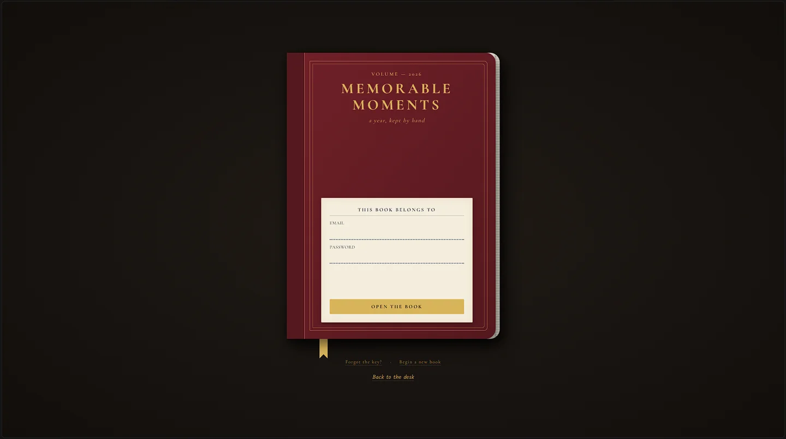
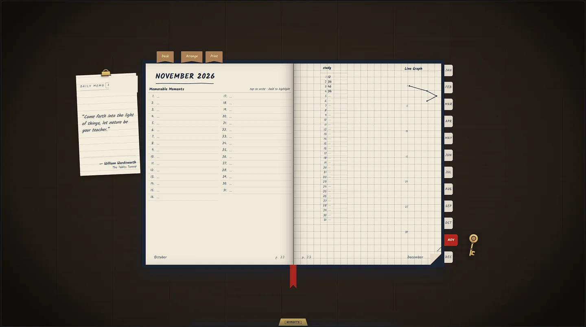
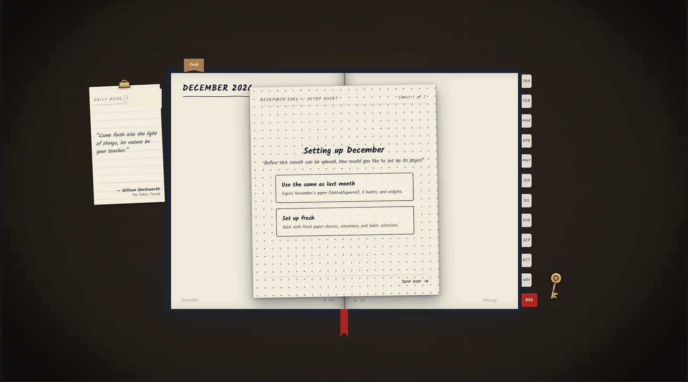
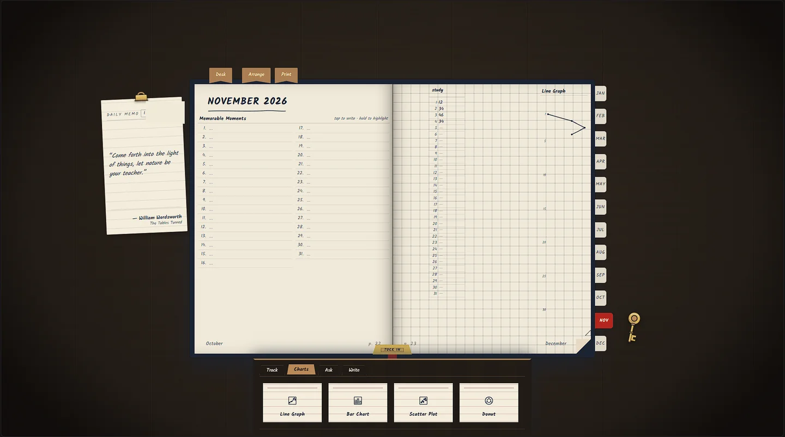

# Memorable Moments

A book-like digital journal. Each month is a two-page spread on a wooden desk. No navbar, no dashboard — only paper, ink, and hand-drawn widgets.

---

## Screenshots

### Login — Book Cover


### Home — The Desk


### Open Book Spread


### Month Setup Wizard


### Widget Library


---

## Features

All features listed here are present in the codebase.

- **Book metaphor** — the journal is a physical book, not a web app. Navigation is via month-tab edge tabs, a bookmark ribbon, and desk-to-book transitions. No sidebar or navbar inside the book.
- **Two-page spread** — desktop (≥ 768 px) renders left and right pages side by side; mobile renders one page at a time. Same data either way.
- **Paper types** — dotted (default), squared, lined, and blank paper, each rendered on a 22 px grid with 1.4 px dots.
- **Month Setup Wizard** — runs before each month can be opened. Offers "copy last month" or "set up fresh" with paper-type and habit selection.
- **Widget Library** — snap-to-grid widgets placed on the page via a tuck-in drawer. Available widget types:
  - Charts: Line Graph, Bar Chart, Scatter Plot, Donut
  - Trackers: Habit Tracker, Mood Tracker, Goal Bar, Number Log
  - Lists: Checklist, Poll, Memorable Moments list
  - Freeform: Free Note, Sticky Note, Counter
- **Custom hand-drawn SVG charts** — no charting library; all chart components are hand-coded SVG with a hand-drawn aesthetic.
- **Custom CSS 3D page turn** — no flip-book library.
- **Offline / PWA** — Serwist service-worker registration (`ServiceWorkerRegister`) with offline sync support (`offlineSync.ts`).
- **Auth-gated journal** — `/home` and `/book/[year]/[month]` require a Supabase session. The public landing page `/` and the closed-book cover `/login` are open to everyone.
- **Row-Level Security** — each user sees only their own books, months, widgets, and entries; enforced by Supabase RLS policies.
- **Public home page** — a desk-scene landing page about focus and journaling; reads no user data.
- **Focus Room** — a public page at `/focus-room` with an ambient focus timer.

---

## Tech Stack

| Layer | Technology |
|---|---|
| Framework | Next.js 16 (App Router), React 19, TypeScript |
| Styling | Tailwind CSS |
| State | Zustand |
| Drag-and-drop | @dnd-kit/core |
| Validation | Zod |
| Backend | Supabase (Postgres, Row-Level Security, Auth) |
| PWA / Offline | Serwist |
| Fonts | Kalam (handwriting), Cormorant Garamond (cover) |
| Deployment | Vercel (region: hnd1) |

---

## Getting Started

### Requirements

- Node.js 20 or later
- A Supabase project (free tier works)
- `pnpm`, `npm`, or `yarn`

### Install

```bash
npm install
```

### Environment Variables

Create a `.env.local` file at the repo root with these keys. **Do not add real values here.**

```
NEXT_PUBLIC_SUPABASE_URL=
NEXT_PUBLIC_SUPABASE_ANON_KEY=
```

### Database

Apply the migrations in order:

```bash
# Using the Supabase CLI
supabase db push
```

Or run the SQL files in `supabase/migrations/` manually in your Supabase SQL editor, in numerical order.

### Run Dev Server

```bash
npm run dev
```

Open [http://localhost:3000](http://localhost:3000).

### Build and Start

```bash
npm run build
npm run start
```

---

## Project Structure

```
app/
  (public)/          # Public routes: landing page, focus room
  book/[year]/[month]/ # Auth-gated journal spread
  home/              # Auth-gated desk (home after login)
  login/             # Book-cover login page

components/
  book/              # OpenBook, ClosedBook, MobileBook
  desk/              # HomeDesk, ClosedBookDesk, PublicDesk
  paper/             # Paper component (dotted, squared, lined, blank)
  widgets/           # All widget components (chart, tracker, list, freeform)
  setup/             # MonthSetupWizard and related helpers
  public/            # Landing page sections, PublicNav, PublicFooter
  pwa/               # ServiceWorkerRegister

lib/
  supabase/          # Supabase client helpers (server and browser)
  tokens.ts          # Design tokens (server-side)
  tokens-public.ts   # Design tokens (public)
  offlineSync.ts     # Offline / optimistic update helpers

store/               # Zustand stores

supabase/
  migrations/        # SQL migration files (applied in order)
  seed/              # Demo seed data

types/
  db.ts              # Generated Supabase database types

public/
  icons/             # PWA icons (192, 512, apple-touch-icon)
  welcome/           # Hero photography assets

docs/
  screenshots/       # README screenshots (processed, redacted)
```

---

## Deployment

The repo includes a `vercel.json` configured for the `hnd1` region. Push to a Vercel-connected Git branch to deploy.

---

## License

TBD
